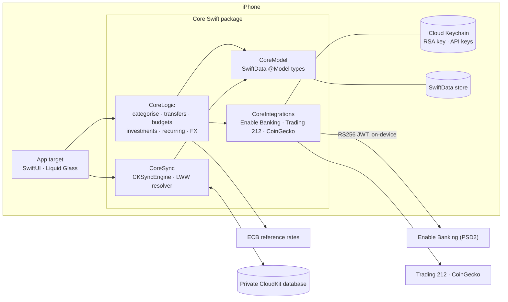

<div align="center">


# Odyssey Finance

**A private, local-first personal finance app for iPhone.**
Bank sync, transfers, shared expenses, budgets and investments — with no server and no account system.
Your data lives on your device and in your own iCloud.

[](https://github.com/Uliseis/OdysseyFinance/actions/workflows/ci.yml)


[](LICENSE)

</div>

---

## Why

Most finance apps want your bank credentials on their servers. Odyssey Finance does the opposite:

- **No backend.** Bank sync talks to the PSD2 aggregator straight from the phone. The signing key lives in your iCloud Keychain.
- **iCloud is the boundary.** Data is stored in SwiftData and synced through your own **private** CloudKit database with `CKSyncEngine`. No shared database, no third-party analytics.
- **Face ID on open.** The app locks itself; there is nothing to log into.
- **EUR-first, multi-currency.** Money is stored and computed as `Decimal`, and converted with daily ECB reference rates.

It started as a Next.js + Postgres web app and was rewritten as a native SwiftUI app. The web version lives on as a frozen reference under [`Spec/`](Spec/).

> **Status:** a personal project in daily use. It isn't on the App Store; you build and sign it yourself.

## Features

| | |
|---|---|
| **Accounts** | Bank accounts synced through [Enable Banking](https://enablebanking.com) (PSD2), plus manual accounts with balance anchors, aliases, groups and archiving. |
| **Spaces** | Split your money into spaces (e.g. *Individual* and *Shared*). The main tabs scope to the selected space. |
| **Transactions** | Fast paged feed with search, category filters, editing, and a quick-add Shortcut (*Log Card Charge*) for Siri, Back Tap or a Wallet automation. |
| **Categorisation** | Rule engine (contains / equals / starts / ends / regex on description or counterparty, with priorities). Manual choices always win. |
| **Transfers** | Automatic pairing of both legs, *transfer routes* that mirror bank-feed lines into manual accounts, manual pairing, and invariants that keep the books balanced. |
| **Shared expenses** | Group an expense with the payments that reimbursed it (Bizum and friends), so only your share counts as spending. |
| **Dashboard** | Net worth, cash flow, *this month* and category breakdowns, budgets, and a configurable budgeting month (for example *starts on the 20th, Friday before a weekend*). |
| **Investments** | Cost basis + valuation history per account, live values from Trading 212 and CoinGecko, period returns, and internal moves (e.g. fund account → pension). |
| **Recurring & automations** | Detects subscriptions (or pin one to a day of the month), can auto-book expected charges and recurring splits, and asks for confirmation with actionable notifications. |
| **Statement import** | Import a Revolut card statement (CSV). It matches existing quick-adds instead of duplicating them. |

## Architecture



- **`App/`**: the SwiftUI target. Feature folders, the Face ID gate, the App Intent and the model container wiring. No business logic.
- **`Core/`**: a platform-agnostic Swift package (iOS and macOS), so the whole domain is tested on the Mac with `swift test`.
- **`Tools/`**: the one-shot migration that moved the web app's Postgres data into a SwiftData store.

The design decisions are written up in [`docs/ARCHITECTURE.md`](docs/ARCHITECTURE.md): the sync conflict policy, deduplication, the transfer model and the investment model.

## Repository layout

```
App/                    SwiftUI app target (features, intents, support)
Core/                   Swift package: CoreModel, CoreLogic, CoreIntegrations, CoreSync + tests
Tools/
  ExportFromPostgres/   Node script: Postgres → JSON dump
  ImportFromPostgres/   Swift CLI: JSON dump → SwiftData store
Spec/                   Frozen copy of the original Next.js app, kept as the porting spec
Vercel/                 Static Apple App Site Association + bank-redirect hosting config
docs/                   Architecture notes
project.yml             XcodeGen spec (the .xcodeproj is generated, not committed)
```

## Getting started

**Requirements:** macOS 26, Xcode 26 (iOS 26 SDK) and [XcodeGen](https://github.com/yonaskolb/XcodeGen).

```sh
brew install xcodegen
xcodegen generate              # creates OdysseyFinance.xcodeproj from project.yml
open OdysseyFinance.xcodeproj  # run the OdysseyFinance scheme on a simulator
```

Simulator builds run unsigned. To run on a device with iCloud sync, change these in `project.yml` to your own values:

- `DEVELOPMENT_TEAM`: your Apple Developer team.
- `bundleIdPrefix` and the iCloud container (`iCloud.<your bundle id>`).

Then regenerate the project.

### Connecting a bank (optional)

1. Create an application in the [Enable Banking control panel](https://enablebanking.com/cp/) and download its private key (`.pem`).
2. In the app, go to **Settings → Connections → Enable Banking** and enter the application ID and the key file. The key goes straight into your iCloud Keychain. It is never written to disk by the app and never committed.
3. Tap **Link a Bank**, pick your bank and authorise. Accounts and transactions sync on launch and whenever the app comes to the foreground (at most every 15 minutes).

Trading 212 live values work the same way: add an API key under **Settings → Trading 212**. CoinGecko needs no key.

## Testing

```sh
swift test --package-path Core
```

The Core package has **440+ tests**, covering FX, categorisation, transfers and their invariants, shared expenses, investments, budgets, recurring detection, statement import, Enable Banking request signing and decoding, and the CloudKit record coding, conflict resolution and pull/push pipelines. All fixtures are synthetic.

## Privacy

This repository contains code only. It holds no bank data, statements, balances or credentials. Test and preview data are invented. If you spot something that looks like real personal data or a secret, please follow [SECURITY.md](SECURITY.md).

## License

[MIT](LICENSE)
