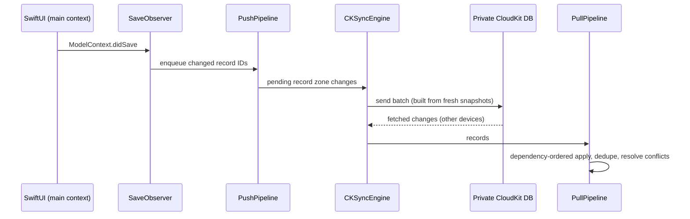

# Architecture

Odyssey Finance is a single-user, local-first iOS app. There is no backend. The device is the source of truth, CloudKit carries it to your other devices, and every integration is called directly from the phone.

## Modules

| Module | Role | Depends on |
|---|---|---|
| `CoreModel` | SwiftData `@Model` types and enums. No logic. | — |
| `CoreIntegrations` | HTTP clients: Enable Banking (PSD2), Trading 212, CoinGecko. On-device RS256 JWT signing and Keychain storage. | `CoreModel` |
| `CoreLogic` | All business rules: FX, categorisation, transfers and routes, invariants, shared expenses, budgets, dashboard maths, investments, recurring detection, automations, statement import, bank-sync orchestration. | `CoreModel`, `CoreIntegrations` |
| `CoreSync` | CloudKit sync with `CKSyncEngine`: snapshots, record coding, conflict resolution, pull/push pipelines, background refresh. | all of the above |
| `App` | SwiftUI views, the Face ID gate, App Intents, model-container wiring. | all of the above |

Everything under `Core/` builds for iOS and macOS, so the domain is tested on the Mac without a simulator.

## Data model

Fifteen SwiftData models: `Connection`, `AccountSpace`, `AccountGroup`, `Account`, `Category`, `CategoryRule`, `TransferRoute`, `TransferGroup`, `Budget`, `FxRate`, `Transaction`, `SharedExpenseGroup`, `PortfolioValuation`, `SyncRun` and `SyncRecordMeta`.

- **Money is `Decimal`**, never `Double`, in storage and in every calculation. Charts convert only to plot. Every transaction stores its original amount and currency, its EUR amount and the ECB rate used.
- **Relationships declare their inverse on one side**, and deletes rely on SwiftData's `.cascade` / `.nullify` rules. `CascadeTests` is the regression guard for that behaviour.
- **Composite uniqueness is enforced in code, not with `#Unique`.** This covers `Transaction(account, externalId)` and `FxRate(date, currency)`. SwiftData's upsert would silently rewrite a row's `id`, which breaks the `CKRecord.recordName == id` sync invariant.
- **Category source** (`bank`, `rule`, `manual`) records who set a transaction's category. The rule engine never overrides a manual choice.

## Sync

- **Snapshots, not models, cross threads.** Each model has a `Sendable` snapshot struct. Records are coded field by field: decimals and UUIDs as strings, enums as raw values, relations as referenced IDs.
- **Conflict policy: last writer wins**, judged by a per-record `updatedAt` clock, with one exception. A manual category beats a non-manual one, so a bank re-sync never undoes a choice you made by hand.
- **Pull is dependency-ordered**, parents before children. A second pass relinks the transaction ↔ shared-expense cycle.
- **Background refresh** runs from a `BGProcessingTask`. Bank sync also runs on launch and on foreground, throttled to once every 15 minutes.

## Bank sync (Enable Banking)

1. You import your Enable Banking application ID and RSA private key once. The key is stored in the iCloud Keychain (`kSecAttrSynchronizable`) and never leaves it.
2. Every API call is authorised with a short-lived **RS256 JWT signed on the device** (`SecKeyCreateSignature`).
3. Linking a bank opens the consent flow in `ASWebAuthenticationSession`. The redirect is an `https` URL on the app's associated domain, which the session intercepts and hands back to the app.
4. Sync fetches balances and transactions per account. A per-connection watermark only advances when every account fetched cleanly. Rows are deduplicated on `(account, externalId)`.
5. Post-processing runs over the new rows: FX conversion, rule categorisation, transfer-route mirrors and transfer detection.

## Transfers

A move between two of your own accounts must not count as spending or income. There are three mechanisms:

- **Detection** pairs a debit and a credit on different accounts in the same space when the EUR amounts are within €0.01 and at most 3 days apart. It only pairs when there is exactly one candidate.
- **Transfer routes** handle a bank line like *"To Savings"* whose other side has no bank feed. The route matches it by pattern and books a *mirror* leg (`mirror:<source id>`) on a manual account.
- **Manual pairing and internal moves** cover everything else, such as splitting a broker deposit between a fund account and a pension wrapper.

`TransferInvariants` checks that every group balances and stays consistent across archive, exclude and space changes.

## Investments

An investment account is modelled like a cash account: an **anchor plus everything booked since**.

- **Cost basis:** an opening figure and date, plus contributions and minus withdrawals after it. Payouts (income-tagged outflows, e.g. rent from a property) are treated as return, not as capital coming back.
- **Value:** the latest valuation, either typed in or refreshed live from Trading 212 (account summary) or CoinGecko (quantity × price). Automatic refreshes are refused when a value moves by more than 100× in either direction against the previous reading. That guards against a mistyped quantity.
- **Returns:** lifetime and per period. A period return divides the gain by the value at the period start plus half the contributions made during it (a simple Dietz return).

## Recurring charges and automations

`Recurring.detect` looks for charges with the same merchant and amount on a stable day of the month (occurrences within 5 days of each other). A charge can also be pinned to a fixed day. Automations can book the expected charge on its day, or book a fixed recurring split after each qualifying arrival. Each booking raises an actionable notification (*Keep*, *Delete*, *Stop This Subscription*, *Undo*), so nothing lands silently.

## Migration from the web app

The app replaced a Next.js + Postgres web app, which is kept read-only under `Spec/`. Migration was a one-shot step:

- `Tools/ExportFromPostgres` (Node) dumps the database to a JSON document.
- `Tools/ImportFromPostgres` (Swift) writes that dump into a SwiftData store, preserving UUIDs, transfer groups and mirror chains.
- The store is then synced up to CloudKit from the device.
