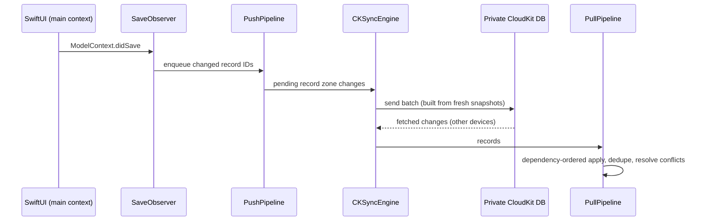

# Architecture

Odyssey Finance is a single-user, local-first iOS app. There is no backend. The device is the source of truth, CloudKit carries it to your other devices, and every integration is called directly from the phone.

## Modules

| Module | Role | Depends on |
|---|---|---|
| `CoreModel` | SwiftData `@Model` types and enums. No logic. | — |
| `CoreIntegrations` | HTTP clients: Enable Banking (PSD2), Trading 212, CoinGecko. On-device RS256 JWT signing and Keychain storage. | `CoreModel` |
| `CoreLogic` | All business rules: FX, categorisation, transfers and routes, invariants, shared expenses, budgets, dashboard maths, investments, recurring detection, automations, statement import, bank-sync orchestration. | `CoreModel`, `CoreIntegrations` |
| `CoreSync` | CloudKit sync with `CKSyncEngine`: snapshots, record coding, conflict resolution, pull/push pipelines, background refresh. | all of the above |
| `App` | SwiftUI views, the Face ID gate, App Intents, model-container wiring. | all of the above |

Everything under `Core/` builds for iOS and macOS, so the domain is tested on the Mac without a simulator.

## Data model

Sixteen SwiftData models: `Connection`, `AccountSpace`, `AccountGroup`, `Account`, `Category`, `CategoryRule`, `TransferRoute`, `TransferGroup`, `Budget`, `FxRate`, `Transaction`, `SharedExpenseGroup`, `PortfolioValuation`, `FundTrade`, `SyncRun` and `SyncRecordMeta`.

- **Money is `Decimal`**, never `Double`, in storage and in every calculation. Charts convert only to plot. Every transaction stores its original amount and currency, its EUR amount and the ECB rate used.
- **Relationships declare their inverse on one side**, and deletes rely on SwiftData's `.cascade` / `.nullify` rules. `CascadeTests` is the regression guard for that behaviour.
- **Composite uniqueness is enforced in code, not with `#Unique`.** This covers `Transaction(account, externalId)` and `FxRate(date, currency)`. SwiftData's upsert would silently rewrite a row's `id`, which breaks the `CKRecord.recordName == id` sync invariant.
- **Category source** (`bank`, `rule`, `manual`) records who set a transaction's category. The rule engine never overrides a manual choice.

## Sync

- **Snapshots, not models, cross threads.** Each model has a `Sendable` snapshot struct. Records are coded field by field: decimals and UUIDs as strings, enums as raw values, relations as referenced IDs.
- **Conflict policy: last writer wins**, judged by a per-record `updatedAt` clock, with one exception. A manual category beats a non-manual one, so a bank re-sync never undoes a choice you made by hand. The clock is stored as `clock` or `updatedAt` depending on the record type (a sync run's is `finishedAt`); `RecordCoding.clock(of:)` reads whichever is there.
- **Repair re-push.** Before the fix below, CloudKit kept values the device had cleared. Launching once with `OFSYNC_REPAIR_PUSH=1` re-queues every record; while that queue drains, a conflict tied on the clock keeps the device's values (a tie is exactly a record whose cleared fields never reached CloudKit), and a genuinely newer server copy still wins.
- **A push sends every field, cleared ones included.** It builds on the cached system fields, which hold no data keys, so the fields come from the record's `changedKeys`. Encoders assign every key, nil included, so a category removed or a transfer unpaired on the phone reaches CloudKit.
- **Pull is dependency-ordered**, parents before children. A second pass relinks the transaction ↔ shared-expense cycle.
- **Background refresh** runs from a `BGProcessingTask` (banks, then investments) and a daily `BGAppRefreshTask` (investments only), whenever iOS chooses to run them. Each starts the sync engine first, since a background launch may never show the scene that starts it. Bank sync also runs on launch and on foreground, and from the *Sync & Refresh* Shortcuts action, which always refreshes investments. A personal automation running that action every morning is the reliable daily refresh. Every bank sync goes through one throttle (`BankSyncThrottle`): the foreground and the action skip banks synced in the last 15 minutes, the processing task banks synced in the last 6 hours. Enable Banking calls carry no PSU headers, so each one counts against the banks' allowance of about four unattended accesses a day per account. A sync that starts holds the banks off for 5 minutes, so one killed mid-way doesn't have every later launch retry at once; only one that read the key and wasn't cut short uses up the interval.
- **New record types and fields reach Production by hand.** The app builds against the Development CloudKit environment, so a new record type or field must be deployed to the Production schema in the CloudKit Console before any Production or TestFlight build.

## Bank sync (Enable Banking)

1. You import your Enable Banking application ID and RSA private key once. The key is stored in the iCloud Keychain (`kSecAttrSynchronizable`) and never leaves it.
2. Every API call is authorised with a short-lived **RS256 JWT signed on the device** (`SecKeyCreateSignature`).
3. Linking a bank opens the consent flow in `ASWebAuthenticationSession`. The redirect is an `https` URL on the app's associated domain, which the session intercepts and hands back to the app. Bank apps that do SCA themselves (Revolut, ING) open the redirect in Safari instead: it then arrives as a universal link, or the page served at the redirect path (`Vercel/ios-callback.html`) forwards it to the `odysseyfinance://` scheme. `RootView.onOpenURL` closes the stale auth sheet and finishes the pending connection, found by the `state` stored before the browser opened.
4. Sync fetches balances and transactions per account. A per-connection watermark only advances when every account fetched cleanly. Rows are deduplicated on `(account, externalId)`.
5. Post-processing runs over the new rows: FX conversion, rule categorisation, transfer-route mirrors and transfer detection.
6. When a bank later exposes an account the user tracked by hand (a credit card added to the consent), it is discovered as a separate parked account. `FeedAdoption` folds it into the manual account: feed rows re-key their manual twins, replace route mirrors with the real paired leg, or move across, and the manual account takes over the feed's identity. From its `feedSince` date, routes no longer mirror into it.

## Transfers

A move between two of your own accounts must not count as spending or income. There are three mechanisms:

- **Detection** pairs a debit and a credit on different accounts in the same space when the EUR amounts are within €0.01 and at most 3 days apart. It only pairs when there is exactly one candidate.
- **Transfer routes** handle a bank line like *"To Savings"* whose other side has no bank feed. The route matches it by pattern and books a *mirror* leg (`mirror:<source id>`) on a manual account.
- **Manual pairing and internal moves** cover everything else, such as splitting a broker deposit between a fund account and a pension wrapper.

A card statement import (Revolut or Amex CSV, on a manual account) never re-adds a transfer leg. Revolut top-ups are dropped by row type. Amex rows carry no type, so a card payment is dropped when it matches a route mirror already on the card (same amount, within 7 days). Create the paying bank's route before importing the first statement that contains a payment.

`TransferInvariants` checks that every group balances and stays consistent across archive, exclude and space changes.

## Investments

An investment account is modelled like a cash account: an **anchor plus everything booked since**.

- **Cost basis:** an opening figure and date, plus contributions and minus withdrawals after it. Payouts (income-tagged outflows, e.g. rent from a property) are treated as return, not as capital coming back.
- **Value:** the latest valuation, either typed in or refreshed live from one of three sources: Trading 212 (account summary), CoinGecko (quantity × price) or fund prices (units held × each fund's price, plus the cash at the broker). Automatic refreshes are refused when a value moves by more than 100× in either direction against the previous reading. That guards against a mistyped quantity. Live values refresh with the bank sync, on pull to refresh and in the background (see Sync). The Trading 212 and EODHD keys, like the bank key, can be read while the iPhone is locked once it has been unlocked after starting up (D18), so background runs value everything; a run before that first unlock values only crypto, and says why.
- **Fund trades:** an investment account can carry the orders imported from the broker's export, one buy or sell per fund (by ISIN) with units and EUR amount. Units, first-in-first-out cost and realised gains per fund come from them, never typed. Cash at the broker is an anchor plus transfers since, minus buys, plus sells (D16). An import needs the orders export and the cash-movements export: a trade's amount is the cash its order really moved (a sale to cash after the tax withheld on its gain, so its credit can fall short of the estimate by the withholding on its first-in-first-out gain), and an order that moved none is a switch leg whose sale takes the amount the other fund's buy received. An import keys each order by day, fund, units and estimated amount, so a later export adds only what is new and corrects amounts saved earlier. The orders export doesn't say in what order one day's orders ran, so each fund's buys and sells are read from the units held today with only each day's closing units kept from going negative. An import is refused whole when the account is archived, a fund held today has no orders in the export (it is incomplete), a fund's buys and sells don't fit exactly one reading, a reading contradicts a saved trade, the saved and new trades don't add up to the units held (a restated amount would save an order twice), or an order has neither a cash movement nor a switch partner. Orders still in progress are not saved: the broker still counts their cash, and a later export brings them back done. They still hold on to the debit already taken for them, so no done order takes it. The app's import form (on the page of an investment account valued from fund prices or already holding fund trades) asks for the units each fund in the export holds today. It fills in a fund's saved units only when the export has no new done orders for it. With new ones the field starts empty, showing the saved units and how many orders are new: saved units plus the new orders read as buys would pass the units check even when one of them was a sale.
- **Fund prices:** an account whose live source is `funds` is valued from its fund trades: the units held at the end of a day at each fund's latest EODHD price on or before it (no more than a week old), plus the cash at the broker that day, in cents (D17). Values are dated by the prices, not by the refresh: a refresh values every weekday since the account's last valuation up to the newest price of any held fund, and that day itself, so a fund that publishes a day later is in the newest value at its previous NAV. A gap of more than 60 weekdays keeps the latest 60 and says so. An automatic value already on the newest day is replaced when it differs, but one typed in or sent by Claude is kept and the refresh says so; with no newer prices nothing is recorded and the refresh says that too. A day a fund held then has no price for is left out and named, never recorded as a partial total. A value is dated at the start of its UTC day, or at the latest transfer booked that day when that's later, so the metrics never add a transfer the value already includes; transfers on later days are added as for any valuation. A fund's name and currency are looked up once and its prices fetched at most once per UTC day, and no request goes out past 15 in a UTC day (the free plan allows 20). A request returns two weeks of NAVs, reaching back to a week before the oldest last valuation of the accounts that need the fund (no further than the free plan's year), including funds sold since. Prices sit in a local cache in Application Support and are never synced; it keeps each fund's daily prices from two weeks back, or from where the request reached, at most 400 days. Older days a request brings that the cache lacks are added too, so an account last valued before the cached days can still be filled; one that moves more than 15% from every day beside it is left out as a misprint. An account's page and its row on Investments show the span of its held funds' newest price days. The cache is saved with the request counted before every request goes out, so a process killed mid-request still counts it, and again after with the answer; one that can't be read is reported as a notice. Last written on an earlier UTC day, it counted none of today's requests, so the refresh starts from an empty cache and its first request writes over the file; written today, or at an unknown time, it counts as the day's requests all used and isn't written over, so it keeps its prices and held jumps if it can be read again. A fund EODHD doesn't list, or has no price for, is asked about again the next UTC day; a rejected key ends the run's requests and is reported once; a request that ends cancelled isn't counted and ends the run's requests. A refresh called while one is running gets that run's outcome, and a caller that goes away (a pull to refresh whose screen closes) doesn't cut the run short for the others. A fund that couldn't be refreshed keeps its cached price, and the refresh names it as a notice, not a failure. The account's values are refused, naming the fund, when the EODHD key or the broker cash anchor is missing, a held fund has no price, a held fund's newest price is more than four business days (Monday to Friday, UTC) old, or a fund isn't priced in euros. In a fetched window, the days after the newest cached price are taken up to the first that moves more than 15% from the day before. The newest day is checked against the last price taken: past 15% it's held as pending, and the account's values stop at that fund's last accepted day until a later day's price settles it: within 15% of the pending price confirms the move along with the days leading up to it at the new level, back near the cached price drops it. A price more than four business days older than the next one is no reference, so no jump is measured against it.
- **Returns:** lifetime and per period. A period return divides the gain by the value at the period start plus half the contributions made during it (a simple Dietz return).

## Recurring charges and automations

`Recurring.detect` looks for charges with the same merchant and amount on a stable day of the month (occurrences within 5 days of each other). A charge can also be pinned to a fixed day. Automations can book the expected charge on its day, or book a fixed recurring split after each qualifying arrival. Each booking raises an actionable notification (*Keep*, *Delete*, *Stop This Subscription*, *Undo*), so nothing lands silently.

## Claude bridge

Claude works on the data from a Mac through a local MCP server, `Tools/OdysseyMCP`, without a server or a second CloudKit client (D13). The two sides only share files in the app's iCloud Drive container, which the Mac sees at `~/Library/Mobile Documents/iCloud~com~uliseis~odysseyfinance/bridge/`.

- **Snapshot.** On foreground, after a bank sync and after applying a batch, the app writes `snapshot.json`: every model as its sync snapshot (full history), plus the per-device settings that change the numbers (pay cycle, selected space, automation settings). The file that leaves the phone has no session ids or tokens, and bank payloads shrink to their transaction code and counterparty names. When nothing changed since the last file (ignoring fetch order), it skips the write unless that file is an hour old, so the large file isn't re-uploaded on every foreground but its age still shows when the app was last open.
- **Replica.** `CoreBridge` rebuilds a snapshot into an in-memory SwiftData store. The server answers every question by running the app's own CoreLogic on it (balances, Dashboard flow and breakdown, transfer checks, an investment account's fund positions with its switches and broker cash ledger), so the Mac and the phone can't disagree. Previews of changes must run on a replica too: CoreLogic saves inside every mutation, so they can never run on a context over the real store.
- **Policy.** `policy.md` in the same folder holds how the user wants things categorised. It names real people, so it never enters git.
- **Mac helper.** macOS syncs the container only while an app that names it is installed, so the minimal Mac app `Tools/OdysseyBridgeHelper` stays in `~/Applications` to claim it (D15). If `brctl status iCloud.com.uliseis.odysseyfinance` reports "app not installed", open the helper once.
- **Changes.** Claude drafts a batch of ops (`BridgeOp`: categorize, create category or rule, re-run rules, pair or unpair, shared groups, valuations, statement import, deleting rows, feed adoption, undoing a pension split, routes, hand-made rows, one-off mirrors, shared expenses that start from a payback, archiving, fund-order imports, and an investment account's broker cash anchor, cost-basis opening and live value source). A statement or a broker export travels inside the batch: Claude names a CSV on the Mac and the server embeds it. Two ops only ask the phone for what it alone can do: `requestBankSync` runs a bank sync after the batch (it skips the 15-minute throttle), and `requestReconnect` opens that bank's connection screen, where the user renews consent. `BridgeExecutor` runs a batch through CoreLogic, op by op; the server runs it on a fresh replica to preview it, and the phone runs the same code on its main context to apply it, so the review shows exactly what applying does. A failed op is rolled back and the rest still run. Undoable ops record how to reverse them; one op that can't be undone (pairing, shared expenses, rule edits, deletes, routes, statement imports, adoption) takes Undo away from its batch, and the review sheet says so. Undoing a fund import deletes the trades it added and puts back the amounts and switch groups it corrected. A preview also lists every pay cycle whose income or spending moves, since route edits and pairing reach back in time.
- **Inbox and results.** A submitted batch lands in `inbox/<id>.json`, signed with the Mac's P256 key (kept in the Mac's login Keychain). With "Accept Changes From Claude" on, the phone previews each batch on a replica of its own data. It applies it straight away only if it is signed by a Mac paired in Settings → Claude and every op is switched on under "Apply Without Review"; otherwise it opens the review sheet, which applies after Face ID. Altered or forged files are rejected. The outcome goes to `results/<id>.json` (with undo ops for the safe set), the inbox file is deleted and the snapshot is rewritten.
- **Pairing.** The server publishes its public key to `keys/<keyId>.json`; the user trusts it on the phone after comparing the fingerprint Claude reports. Signing stops files dropped by other programs and other devices on the account. It doesn't stop a program on the paired Mac that runs the server itself, which is why every auto-apply switch is off until turned on, and turning one on takes Face ID.

## Migration from the web app

The app replaced a Next.js + Postgres web app, which is kept read-only under `Spec/`. Migration was a one-shot step:

- `Tools/ExportFromPostgres` (Node) dumps the database to a JSON document.
- `Tools/ImportFromPostgres` (Swift) writes that dump into a SwiftData store, preserving UUIDs, transfer groups and mirror chains.
- The store is then synced up to CloudKit from the device.
